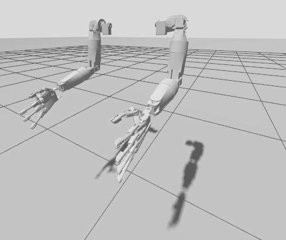

# semubot_arm_description

## **Overview**
Description package for the SemuBot arm and hand. One xacro macro builds a left or right arm: 6 arm joints, a hand and 5 finger joints. It is meant to be included by [semubot_description](https://github.com/SemuBot/semubot_description), and can also be viewed on its own.


## **Joints**
All joints are revolute and named `<side>_<joint>_joint`, with `side` = `left` or `right`.

| Joint | Moves | Positive direction |
|---|---|---|
| `shoulder_pitch` | whole arm | forward |
| `shoulder_roll` | whole arm | inward, towards the body |
| `shoulder_yaw` | upper arm twist | |
| `elbow` | forearm | bends forward |
| `wrist_yaw` | forearm twist | |
| `wrist_roll` | hand | |
| `thumb`, `index`, `middle`, `ring`, `little` | one finger each (one servo per finger) | closing |

Left and right mirror each other: the same joint value gives the mirrored motion.

Joint limits and link masses are estimates; set them from the real servos and parts.

## **Building the package**
```bash
cd ~/<YOUR_WORKSPACE_NAME_HERE>/src
git clone https://github.com/SemuBot/semubot_arm_description.git
cd ..
rosdep install --from-paths src --ignore-src -r -y
colcon build --packages-select semubot_arm_description
source install/setup.bash
```

## **Viewing the arms**
```bash
ros2 launch semubot_arm_description display_arm.launch.py              # both arms, joint sliders
ros2 launch semubot_arm_description display_arm.launch.py side:=right
```
`gui:=false` runs without the sliders (no `joint_state_publisher_gui` needed). On a Wayland desktop, prefix the command with `QT_QPA_PLATFORM=xcb` if RViz shows no 3D view.

## **Gazebo**


```bash
ros2 launch semubot_arm_description gazebo.launch.py              # side:=right|left|both
ros2 topic pub --once /right_elbow_joint/cmd_pos std_msgs/msg/Float64 "{data: 1.0}"
```
The arms hang from a fixed point 1 m up. Every joint holds the angle last sent to `/<side>_<joint>_joint/cmd_pos` (rad); `/joint_states` comes back from Gazebo. Needs `ros_gz_sim` and `ros_gz_bridge`.

## **Using the arm in another robot**
```xml
<xacro:include filename="$(find semubot_arm_description)/urdf/arm.xacro"/>

<xacro:semubot_arm side="right" parent="main_body">
  <origin xyz="0 -0.2 0.55" rpy="0 0 0"/>
</xacro:semubot_arm>
```
`<side>_arm_base` is the shoulder mount; its origin lies on the shoulder pitch axis.


## **License**
This project is licensed under the Apache 2.0 license - see the [LICENSE](LICENSE) file for more information.
